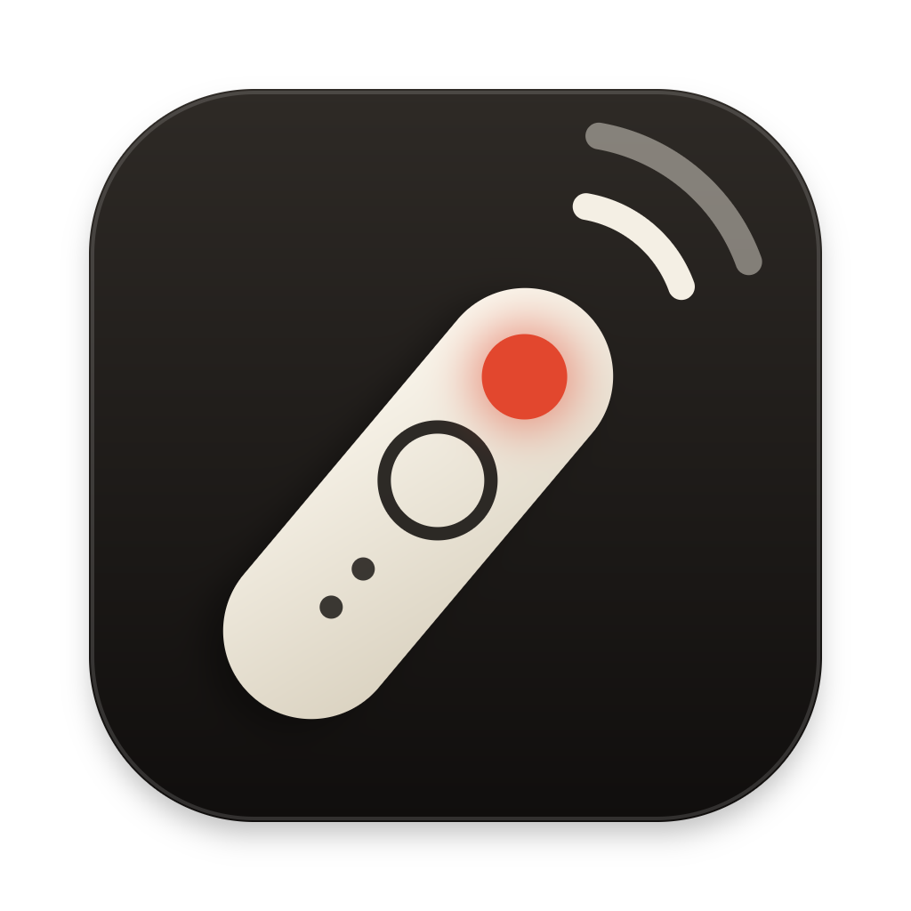
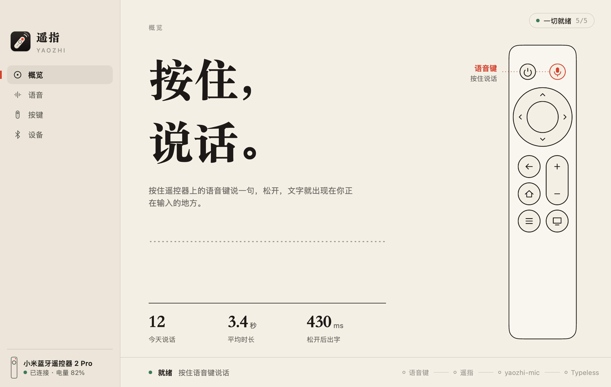
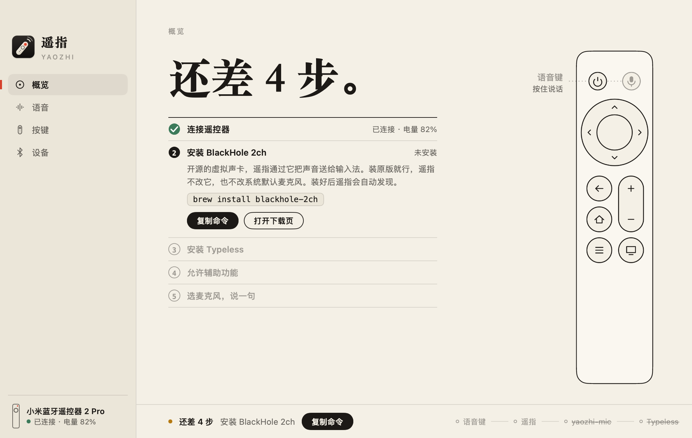
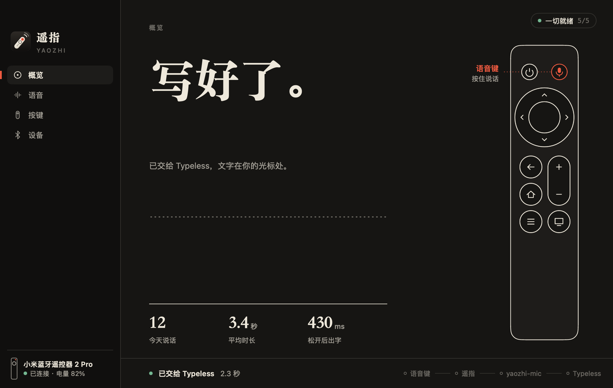

<div align="center">



# 遥指 Yaozhi

**用遥控器指挥你的 Mac。**

按住遥控器的语音键说话，松开，文字就出现在光标处。

[](https://github.com/zJiaJun/yaozhi/actions/workflows/ci.yml)
[](https://github.com/zJiaJun/yaozhi/releases)
[](LICENSE)


</div>



遥指把蓝牙遥控器变成 Mac 的控制器。第一项功能是**语音输入**：遥控器当麦克风，交给你已经在用的语音输入法转成文字。之后会加上自定义按键、切换应用，并支持更多遥控器。

> [!NOTE]
> 遥指还在开发早期（[M1](docs/ROADMAP.md#m1-语音输入)）。语音输入已经能在真机上用，界面和功能还会调整。

## 特性

- **按住说话**：按下语音键开始，松开结束。开头的声音先缓存，等输入法准备好再送过去；结尾等声音全部送完才结束，不丢字。
- **不识别、不存音频**：遥指只传递声音，由你选的输入法识别。音频不落盘、不上传，日志里也不记录说了什么。
- **不改你的系统**：不修改系统默认的输入和输出设备，不改虚拟声卡；只屏蔽这一个遥控器的语音键，其他键和其他键盘不受影响。
- **引导到出字为止**：首次打开时，概览页就是五步清单，缺什么补什么，最后在遥指自己的输入框里说一句，看到文字才算完成。
- **菜单栏常驻**：关掉窗口后留在菜单栏，可以随时暂停，暂停时语音键交还给系统。
- **纯 Go**：界面用 [MyGo](https://github.com/egoist/mygo) 原生绘制，系统接口通过 [purego](https://github.com/ebitengine/purego) 调用，不用 cgo，打包后约 10 MB。

<table>
  <tr>
    <td></td>
    <td></td>
  </tr>
  <tr>
    <td align="center">首次打开：五步引导</td>
    <td align="center">深色外观</td>
  </tr>
</table>

## 支持的设备和输入法

| 类型 | 已支持 | 计划 |
|---|---|---|
| 遥控器 | 小米蓝牙遥控器 2 Pro（RC003） | 其他走 ATVV 协议的语音遥控器 |
| 语音输入法 | [Typeless](https://www.typeless.com) | Handy 等"虚拟麦克风 + 快捷键"类的输入法 |

设备和输入法的差异写在 TOML 文件里（[`xiaomi-rc003.toml`](internal/device/devices/xiaomi-rc003.toml)、[`typeless.toml`](internal/voice/presets/typeless.toml)），同类的新设备和输入法不用改代码。

## 工作原理

```
遥控器 ──BLE·ATVV──▶ 遥指 ──16 kHz PCM──▶ BlackHole 2ch ──▶ yaozhi-mic ──▶ Typeless ──▶ 光标处的文字
                      │                                                       ▲
                      └──────────────────── 模拟 Fn 点按（开始 / 结束） ──────┘
```

1. **声音**：遥控器通过 BLE 上的 ATVV 协议（Android TV 语音协议）发送 IMA ADPCM 音频。遥指解码成 16 kHz 单声道，写入虚拟声卡 [BlackHole 2ch](https://github.com/ExistentialAudio/BlackHole)。
2. **麦克风**：Typeless 的麦克风列表会去掉名字带 "(Virtual)" 的设备，看不到 BlackHole。遥指自动创建一个只包含 BlackHole 2ch 的聚集设备 `yaozhi-mic`，在 Typeless 里选它即可。
3. **开始和结束**：Typeless 用"点一下 Fn 开始、再点一下结束"，遥控器是按住说话。遥指屏蔽遥控器语音键原本发出的 F5，按下时模拟一次 Fn，松开并等声音送完后再模拟一次。

## 安装

### 准备

- 一台 Apple Silicon 的 Mac，macOS 13 或更新（目前在 macOS 26 上测试）
- 已经和 Mac 配对的小米蓝牙遥控器 2 Pro
- [BlackHole 2ch](https://github.com/ExistentialAudio/BlackHole) 和 [Typeless](https://www.typeless.com)：

  ```bash
  brew install blackhole-2ch typeless
  ```

  遥指不打包、不修改 BlackHole。请只把 2ch 版本留给遥指：BlackHole 是回环设备，任何 App 播放到里面的声音都会被输入法一起听到。如果还要录系统声音，另装 16ch 给录屏用。

### 下载

1. 在 [Releases](https://github.com/zJiaJun/yaozhi/releases) 下载最新的 `yaozhi-<版本>-arm64.dmg`，打开后把 Yaozhi 拖进"应用程序"。
2. 第一次打开时 macOS 会提示无法验证开发者。点"完成"，然后打开"系统设置 → 隐私与安全性"，在页面底部点"仍要打开"。

> [!NOTE]
> 遥指目前用自签名证书签名，还没有经过 Apple 公证，所以第一次打开需要手动放行。之后的版本都用同一张证书签名，升级时直接替换即可，蓝牙和辅助功能的授权会保留。

### 从源码编译

需要 Go 1.27.3（版本写在 [`.go-version`](.go-version)，用 goenv 时会自动切换）。

```bash
git clone https://github.com/zJiaJun/yaozhi.git
cd yaozhi
make yaozhi
```

```bash
scripts/yaozhi.sh
```

`make yaozhi` 打包出 `build/darwin-arm64/Yaozhi.app`，`scripts/yaozhi.sh` 启动它并把日志接到当前终端；`make dmg` 另外打出磁盘映像。

> [!IMPORTANT]
> 不能直接运行编译出来的二进制。macOS 要求访问蓝牙的程序在 `Info.plist` 里写明用途，直接运行会被系统杀掉（退出码 134，没有输出）。

## 使用

第一次打开时，概览页会列出还差的几步，按顺序做完即可：

1. **连接遥控器**：点"继续"后系统会询问蓝牙权限。还没配对的话，同时长按遥控器的主页键和菜单键进入配对。
2. **安装 BlackHole 2ch**：装好后遥指自己发现，并创建 `yaozhi-mic`。
3. **安装 Typeless**：装好并打开它。
4. **允许辅助功能**：遥指只用它来模拟 Fn 点按。点"去授权"，把 Yaozhi 拖进系统设置里的列表。
5. **选麦克风，说一句**：在 Typeless 的"选择麦克风"里选 `yaozhi-mic`，然后按住语音键说一句，文字出现在遥指的输入框里就完成了。

之后在任何输入框里，按住语音键说话、松开，文字就出现在光标处。

> [!TIP]
> 如果按 Fn 会弹出表情或听写，把"系统设置 → 键盘 → 按下 🌐 键时"改为"不执行任何操作"。

### 常见问题

<details>
<summary>按住说话没反应</summary>

看菜单栏图标右下角有没有提醒点，有的话打开主窗口按提示补齐缺少的一步。语音输入被暂停时，语音键会交还给系统，在菜单栏选"启用语音输入"即可。
</details>

<details>
<summary>Typeless 开始听写了，但没有文字</summary>

确认 Typeless 的"选择麦克风"选的是 `yaozhi-mic`，而不是"系统默认"或其他设备。声音太小时，可以在"语音"页调高音量增益。
</details>

<details>
<summary>每次重新编译都要重新授权</summary>

这是临时签名的限制。照 [开发文档](docs/DEVELOPMENT.md#签名) 建一张本机自签名证书 `yaozhi-dev`，之后重新编译不用再授权。
</details>

<details>
<summary>需要提交问题时附上什么</summary>

在"设备"页点"导出诊断"，会生成一份包含版本、系统、状态、音频设备和最近日志的文本文件（不含语音内容），附在 issue 里即可。
</details>

## 隐私

- 遥指不做语音识别，音频只在内存里经过，不保存、不上传。
- 日志和导出的诊断不包含语音内容；"试一试"输入框里的文字只在内存里。
- `~/Library/Application Support/Yaozhi/` 下只存设置和使用次数（`settings.json`、`stats.json`）。
- 遥指不联网。

## 路线图

- **M0 技术验证** ✅：Go 能打通蓝牙、解码、虚拟声卡和模拟按键，见 [技术选型](docs/TECH_CHOICES.md)。
- **M1 语音输入** 🚧：按住说话、首次引导、菜单栏、签名发布。
- **M2 控制 Mac**：自定义按键、单击/双击/长按、切换应用、按当前 App 切换键位。
- **M3 更多设备**：第二款 ATVV 遥控器、设备选择。

详见 [ROADMAP](docs/ROADMAP.md)。

## 参与开发

```bash
make check   # gofmt 检查、go vet、go test -race
```

编译运行、签名、调试参数、项目结构和设计稿见 [开发文档](docs/DEVELOPMENT.md)。界面设计稿在 [`docs/design/index.html`](docs/design/index.html)。

欢迎提 issue 和 PR。提交前请跑 `make check`；协议和解码这类纯逻辑请附单元测试。

## 来源与许可

遥指以 [GPL-3.0-only](LICENSE) 发布。

ATVV 协议处理参考了以下 GPL-3.0 项目：

- [open-voice-bridge](https://github.com/nijez/open-voice-bridge)：已在 macOS 真机验证的 RC003 适配器
- [remote-mic-app（无线麦 SayAll）](https://github.com/HD838A/remote-mic-app)
- [remote-bridge-hub](https://github.com/xxb26553663-star/remote-bridge-hub)

具体对应关系：

- `internal/atvv` 的 ADPCM 解码以 open-voice-bridge 为准，测试数据取自它。
- `internal/device/atvvble` 的连接流程（先找系统已连接的设备；订阅 Audio 和 Control 后再请求能力）参考了 open-voice-bridge 的 `XiaomiBluetoothBridge.swift`；RC003 设备描述里的名字、型号和按键 usage 取自它的 `VoiceBridgeDeviceProfile.swift`、`AppSettings.swift` 和 `RemoteButtons.swift`。
- `internal/macinput` 屏蔽 F5（`UserKeyMapping`，只还原自己改的那一条）和模拟 Fn 点按（键码 63、120 ms）参考了 remote-mic-app 的 `RemoteVoiceFunctionMapper.swift` 和 `KeyboardInjector.swift`。
- `internal/voice` 的语音会话流程（先缓存开头、点按后放出、等播完再点按结束）参考了 remote-mic-app 的 `VoiceFnTapSessionController.swift`。
- `internal/coreaudio` 的 AudioQueue 用法参考了 [MyGo](https://github.com/egoist/mygo)（MIT）的 `audio/output_darwin.go`。

第三方依赖：[purego](https://github.com/ebitengine/purego)（Apache-2.0）、[MyGo](https://github.com/egoist/mygo)（MIT，其权限引导插件参照 [PermissionFlow](https://github.com/jaywcjlove/PermissionFlow)，MIT）、[BurntSushi/toml](https://github.com/BurntSushi/toml)（MIT）。

界面里的遥控器是自己画的矢量线稿，不含实物照片。BlackHole 由用户自行安装，不随本项目分发。"小米"和"Xiaomi"是其权利人的商标，本项目与小米无关。
